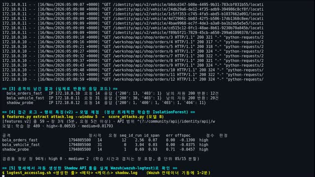
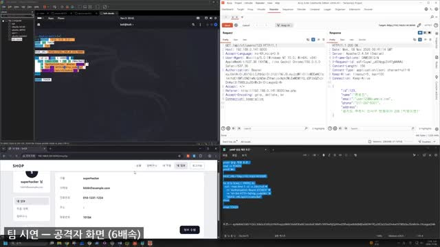
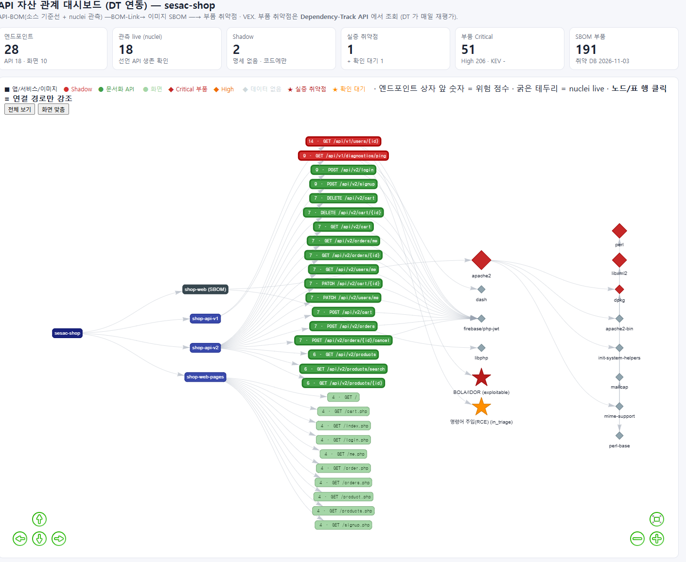
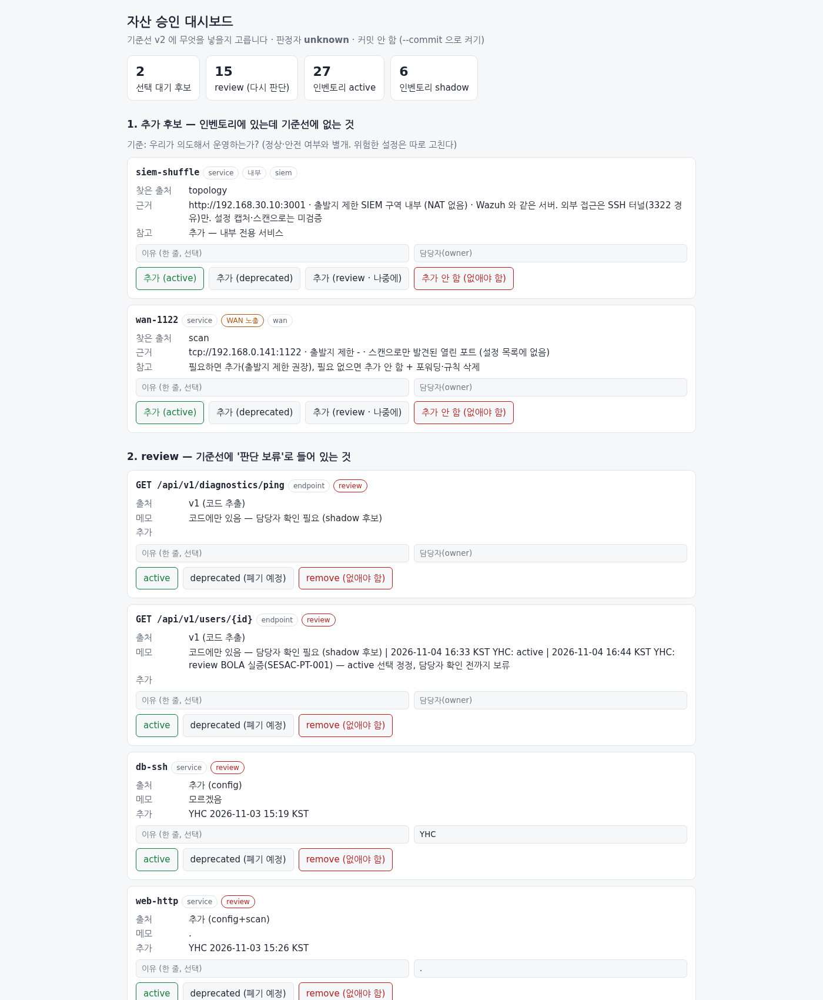
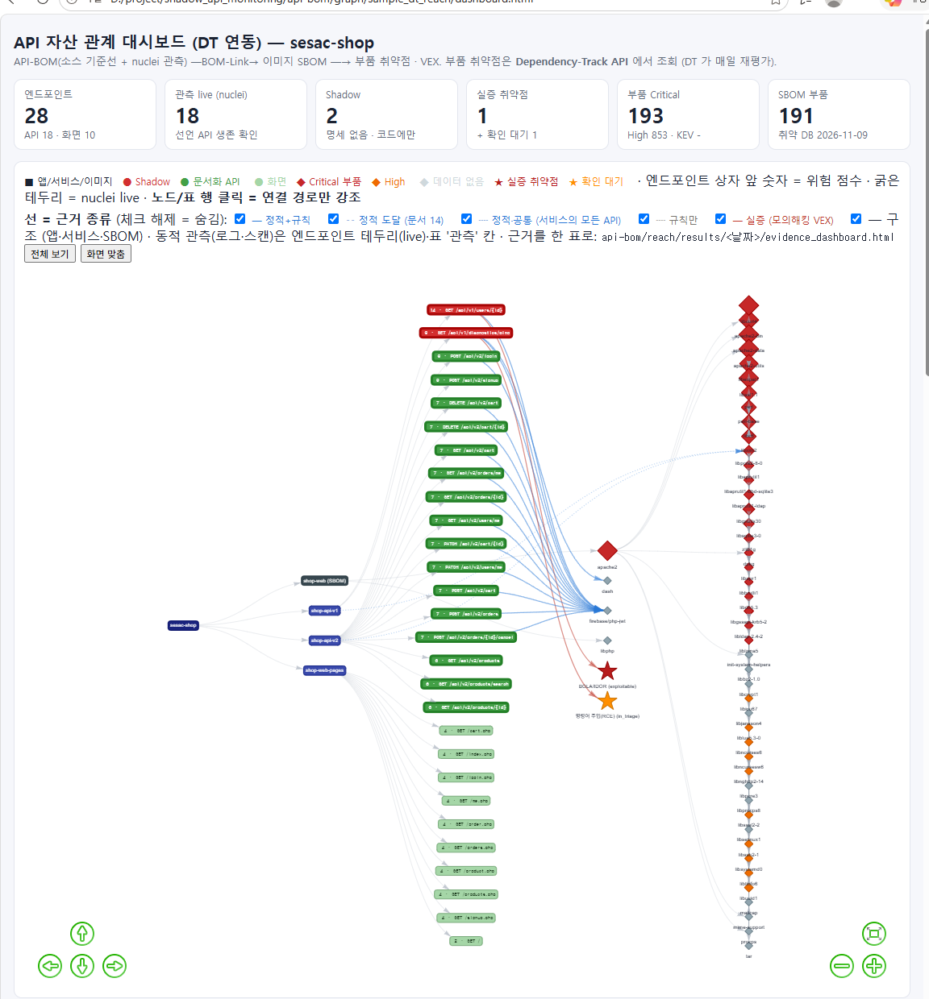
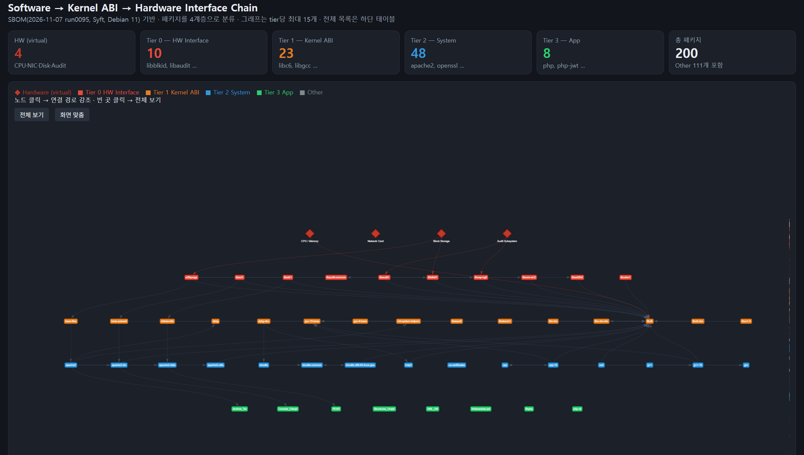

# API 보안 · 소프트웨어 공급망 — 표준화와 자동화

> **명세가 없는 서비스에서 "무엇이 정상 API 이고 무엇으로 만들어졌나"를 표준 형식으로 만들고, 그 기준으로 탐지 룰 생성부터 대응까지 자동으로 돌린다.**
> 행위 기반 ML 은 룰로 못 쓰는 공격(느린 BOLA 열거)을 보완하는 층으로 붙이고, 모든 수치는 다른 앱(OWASP crAPI)에서 다시 검증했다.

이현정 · 보안 엔지니어 과정(SeSAC) 최종 팀 프로젝트의 담당 파트(**API 명세화 · 탐지 룰 파이프라인**)에서 출발해 개인적으로 확장한 저장소입니다.

| 영상 | |
|---|---|
| [](media/demo_mine_live_2x.mp4) | **개인 확장 — 실제 화면 녹화 (78초, 2배속)** crAPI 에 실제 BOLA 공격 → 접근 로그 → 행위 특징·모델 채점 → 명세에서 자동 생성한 룰을 실제 Wazuh 로 확인 |
| [](media/demo_team_edited_6x.mp4) | **팀 프로젝트 시연 (편집본, 108초, 6배속)** 공격자 화면(구버전 API 의 BOLA) → 관제 화면(명세 밖 호출 경보, 차단) |

---

## 1. 표준화 — 기준을 표준 형식으로

| 무엇을 | 표준 | 코드 |
|---|---|---|
| 정상 API 목록(기준) | **CycloneDX 1.6 API-BOM** → OpenAPI 허용 목록 | [`standardize/api-bom/source_to_baseline.py`](standardize/api-bom/source_to_baseline.py) |
| 자산 인벤토리 (소스·방화벽 설정·로그·스캔 4출처) | CycloneDX 서비스 BOM | [`standardize/inventory/`](standardize/inventory/) |
| 소프트웨어 구성 | **SBOM** (Syft, CycloneDX) → Dependency-Track | [`standardize/sbom/`](standardize/sbom/) |
| 취약점 영향 판단 | **VEX** (도달하지 않는 CVE = not_affected 후보) | [`standardize/sbom/make_vex.py`](standardize/sbom/make_vex.py) |
| 판정 기준 | OWASP · CIS · NIST 기반 기준표 | [`standardize/policy/`](standardize/policy/) |

- **사람이 승인한 것만 기준이 된다.** 발견한 API 를 자동으로 기준에 넣으면 공격 대상 경로까지 "정상"이 되어 경보가 꺼진다. 도구는 후보만 내고 사람은 승인만 한다([`approval_server.py`](standardize/inventory/approval_server.py)).
- **결과** (팀 웹): 소스만 보면 Shadow 0 → 4출처를 합치면 **Shadow 4 · 외부 노출 4**. 부품 취약점 2,355건 중 API 에서 실제로 닿는 CVE 는 **23%**([`standardize/reach/`](standardize/reach/), 정적 분석).
- **관계 그래프:** 엔드포인트 → 서비스 → 이미지 → 부품 → 취약점 → 커널 계층 ([`standardize/graph/`](standardize/graph/)).



### 승인 대시보드 — 사람은 "승인"만 한다

| 자산 승인 (기준선 v2) | 예외 승인 (v3 일반 기준) |
|---|---|
|  |  |

- **자산 승인:** 인벤토리에 있는데 기준선에 없는 것(추가 후보)과 판단 보류(review)를 버튼 하나로 고른다 — 추가(active) · 폐기 예정 · 보류 · 추가 안 함. 기준은 "우리가 의도해서 운영하는가"이고, 고른 결과는 누가·언제·무엇을·왜와 함께 기록돼 인벤토리와 탐지 룰이 다시 만들어진다 ([`approval_server.py`](standardize/inventory/approval_server.py)).
- **예외 승인:** 일반 기준(G1~G9 · S1~S4) 위반은 기본적으로 **고칠 대상**이다. 고치지 않고 둘 것만 사유와 **만료일 필수**로 예외 승인한다 ([`exception_server.py`](standardize/policy/exception_server.py)).
- 위 화면은 저장소에 남은 실제 판정 데이터로 서버를 띄워 캡처한 것이다(대기 후보 2 · 보류 15 / 위반 높음 37 · 중간 21).

### 근거 대시보드 — "왜 위험한가"를 근거 종류별로

| 근거 표시 관계 그래프 | 엔드포인트 위험 순위 (근거 칸) |
|---|---|
|  |  |

- 엔드포인트 하나에 **동적**(로그 관측 · 블랙박스 스캔 · nuclei) · **실증**(VEX) · **정적**(코드 호출 경로로 닿는 부품) 근거를 나란히 놓는다. 그래프에서는 선 모양이 근거 종류이고 체크박스로 켜고 끈다 ([`evidence_dashboard.py`](standardize/reach/evidence_dashboard.py), [`build_relations.py`](standardize/graph/build_relations.py)).
- 시작은 "API-BOM 과 SBOM 이 그래프에 나열만 돼 있고 실제로는 이어져 있지 않다"는 문제 제기였다. 코드 호출을 따라 잇고 나서야 **고유 CVE 403개 중 309개(77%)가 어떤 엔드포인트에서도 닿지 않는다**는 결과가 나왔다. 결과를 믿기 전에 분석기 버그 5개(엉뚱한 핸들러, 인증 조건 무시, 미해석 호출 200여 건 등)를 먼저 고쳤다.
- 순위 1위: `GET /api/v1/users/{id}` — Shadow + 개인정보 + 실증된 BOLA + 닿는 Critical 부품.
- 한계: 이 앱에서는 닿는 CVE 94개가 전부 런타임 공통 부품(apache2 · glibc)이라 **엔드포인트 사이 순위를 가르지는 못한다.** 가치는 소음 제거와 영향 범위(셸에 닿는 건 `ping` 하나, JWT 라이브러리는 인증 경로만)다. 분석은 정적이고 PHP 라우팅에 맞춰져 있다.

## 2. 자동화 — 기준에서 룰, 룰에서 대응까지

```
소스·설정·로그·스캔 ─▶ API-BOM / SBOM ─▶ (사람 승인) ─▶ OpenAPI 허용 목록 ─▶ Wazuh 룰 자동 생성·시험
                                                                              │
                     공격 ─▶ 접근 로그 ─▶ Wazuh ─▶ Event-Driven Ansible ─▶ 차단 · 계정 정지 · 자동 해제
                                         ▲
                     행위 특징 ─▶ ML 점수 ─┘
```

| 자동화 | 내용 | 코드 |
|---|---|---|
| 매일 수집 | GitHub Actions — SBOM 생성, API-BOM, 룰 생성·시험 | [`automate/github-actions/`](automate/github-actions/) (원본 저장소 경로 기준) |
| 룰 자동 생성 | 명세 → 메서드별 허용 경로 → "명세 밖 호출" 룰 + 응답 코드별 단계 | [`automate/rules/gen_shadow_rules.py`](automate/rules/gen_shadow_rules.py) |
| 대응을 코드로 | Wazuh → EDA → Ansible 플레이북. 허용 목록 한 곳, 60분 자동 해제, BOLA 는 **계정 정지** | [`automate/response/`](automate/response/) |
| 이식 가능한 워크플로 | 명세 → 룰 → 수집 → 특징 → 학습 → **평가 게이트** → 배포. 설정 파일만 바꿔 다른 앱에 | [`automate/portable-workflow/`](automate/portable-workflow/) |

- **룰을 실제 Wazuh 로 검증:** 배포돼 있던 BOLA 룰이 거꾸로 동작(막힌 시도는 차단, 성공한 열거는 미탐)하는 것을 `wazuh-logtest` 로 찾아 고쳤다 ([`automate/rules/wazuh_rules_v2/`](automate/rules/wazuh_rules_v2/README.md)).
- **"돈다 ≠ 잘 된다":** 학습한 모델은 공격 변종·정상 오탐 기준을 통과해야만 배포한다.


## 3. 보안 ML — 룰이 못 쓰는 행위를 보완

| 비교 (실제 랩 로그) | 빠른 BOLA | 느린 BOLA (출발지 7곳) | 정상 오탐 |
|---|---|---|---|
| 빈도 룰 (120초에 객체 10개) | 일부 | **전부 미탐** | 0 |
| 임계값 룰 (5분에 객체 5개) | 전부 | 205/210 | 0/356 |
| ML (LOF) | 34/35 | **210/210** | 52/356 (14.6%) |

- 결론을 한쪽으로 몰지 않았다. 느린 BOLA 는 빈도 룰이 놓치고 ML 이 잡지만, BOLA 만 보면 임계값 룰이 오탐 0 으로 같은 일을 한다. ML 의 몫은 룰을 미리 쓰지 않은 종류다 ([`ml/docs/37_…`](ml/docs/), 재현 `bash ml/docs/37_결과/run.sh`).
- 모델 카드: [`ml/docs/MODEL_CARD.md`](ml/docs/MODEL_CARD.md) — 처음 보는 정상 사용자 오탐 10~15% (PoC, 운영 전).

## 4. 검증 — 다른 앱(OWASP crAPI)에서 다시

| 항목 | 고치기 전 | 고친 뒤 |
|---|---|---|
| 룰 생성 | 자체 시험 61/64 로 중단 | 72/72 |
| 생성된 룰 (실제 Wazuh) | crAPI 요청에 한 번도 안 걸림 | 명세 밖 14줄 중 10줄 경보 · 정상 400줄 0 |
| 주소 뒤 `?id=N` · UUID 열거 | 못 봄 | 탐지 (남의 차량 위치 20대) |
| 평가 게이트 | 실패 | 통과 |

| 학습에 쓴 정상 트래픽 | 실제 공격 17구간 | 사람 속도 정상 오탐 |
|---|---|---|
| 스크립트만 | high 17 | **115/120** |
| 스크립트 + 공개 데이터 재생 (OTTO · Stack Overflow) | high 15 · medium 1 | 3/120 |

상세: [`verify/crapi/`](verify/crapi/) · [`automate/portable-workflow/README.md`](automate/portable-workflow/README.md)

## 5. 다음 목표 — 소프트웨어에서 커널까지



- SBOM 패키지 200개를 앱 → 시스템 → 커널 ABI → 하드웨어 인터페이스 계층으로 나눠 이은 화면 ([`kernel_hw_chain.py`](standardize/graph/kernel_hw_chain.py)).
- **아직 결과가 아니라 방향이다.** 계층은 패키지 이름 규칙으로 나눴고(200개 중 111개는 미분류), 하드웨어 노드는 가정해서 그렸고, 선은 패키지 의존 관계다.
- 다음 단계는 이 선을 **실행 중 관측**으로 바꾸는 것: 요청을 처리한 프로세스가 실제로 로드한 라이브러리(strace · eBPF)와 실제로 부른 커널 기능을 이어, 근거 대시보드의 "정적" 칸 옆에 "런타임" 칸을 만든다.

## 6. 스스로 정정한 것

| 처음 주장 | 정정 | 어떻게 찾았나 |
|---|---|---|
| ML 오탐 0/65 | 10~15% | 정상을 시각순이 아니라 출발지 단위로 나눔 |
| 합성 데이터에서 "느린 BOLA 는 LOF 만 잡는다" | 철회 | 피처 하나로 전부 갈리는 지름길 발견 |
| 설정만 바꾸면 다른 앱에서도 된다 | 틀림 | crAPI 에 직접 돌림 |
| 팀 웹 로그에서 ML 이 룰보다 더 잡는다 | 근거 없음 | 룰을 통과한 공격 구간 중 ML 탐지 0 |

## 한계

- 정상 트래픽은 스크립트와 공개 데이터 재생이다. 실제 서비스의 오탐률은 모른다.
- 행위 단위가 출발지 IP 라 여러 IP 로 나눈 공격은 탐지 0%. 계정·토큰 단위가 다음 단계다.
- 도달성 분석은 정적 분석이다. 실행 중 실제로 로드된 라이브러리·커널 기능을 잇는 것이 다음 목표다.
- 확인한 앱은 팀 웹과 crAPI 둘뿐이다.

## 구성

| 폴더 | 내용 |
|---|---|
| `standardize/` | API-BOM · 인벤토리 · SBOM · VEX · 판정 기준 · 관계 그래프 · 도달성 |
| `automate/` | CI · 룰 생성 · Wazuh 룰 v2 · 대응(Ansible/EDA) · 이식 가능한 워크플로 |
| `ml/` | 행위 특징 · 학습 · 탐지 · 평가(변종 · 게이트) · 랩 실험 코드 · 모델 카드 · 랩 로그 |
| `verify/crapi/` | crAPI 검증 기록 · 트래픽 생성기 |
| `media/` | 시연 영상 2개 · 대시보드 그림 · 녹화 스크립트 |

코드는 원본 저장소에서 골라 옮긴 것이라 일부 스크립트의 경로(`api-bom/…`, `e2e_story/…`, `team_one/…`)는 원본 구조 기준이다. 팀 프로젝트의 웹 애플리케이션 소스는 포함하지 않았다.
