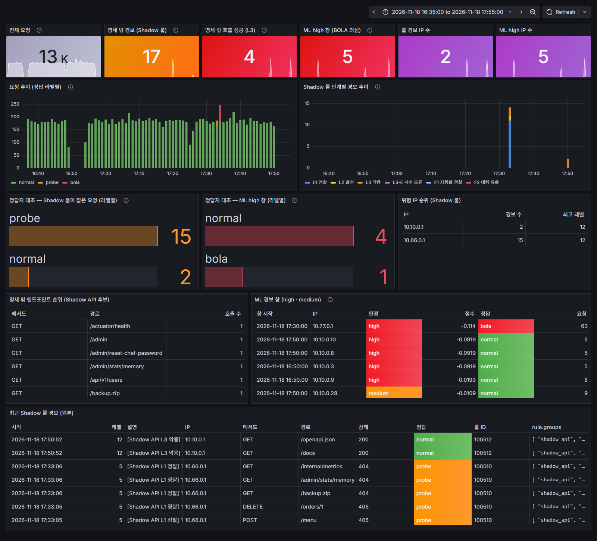
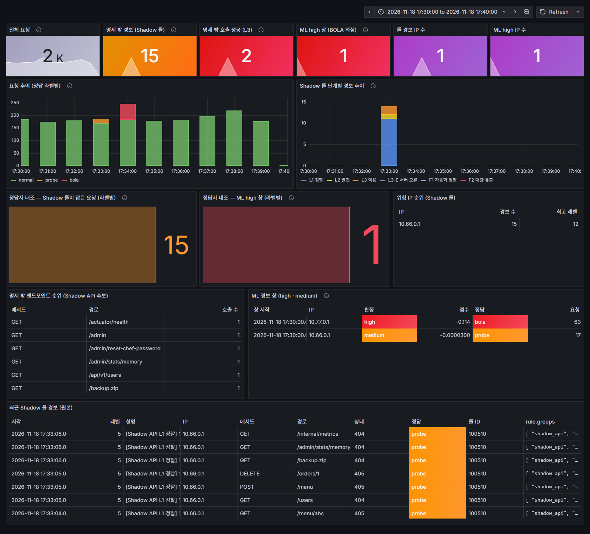

# DVRA 탐지 대시보드 — Shadow 룰(실제 Wazuh) + ML(BOLA)를 한 화면에 (2026-11-18)

DVRA ML 2차 수집([`../dvra/ml_run2_2026-11-18/`](../dvra/ml_run2_2026-11-18/README.md))을 Grafana 로 본다.
대시보드는 **코드로 만든다**(`build_dashboard.py` → JSON → Grafana 프로비저닝). 클릭으로 만든 화면이 아니라서 Git 으로 고치고 되돌릴 수 있다.



공격 구간만 (17:30~17:40 KST): **탐색 15건은 Shadow 룰이, 남의 주문 열거(BOLA)는 ML 이** 잡는다.



## 무엇을 보여 주나

| 줄 | 패널 | 데이터 |
|---|---|---|
| 1 | 전체 요청 · 명세 밖 경보 · 명세 밖 호출 성공(L3) · ML high 창 · 경보 IP 수 | 요청 · 경보 · ML |
| 2 | 요청 추이(정답 라벨별) · Shadow 룰 단계별 경보 추이 | 요청 · 경보 |
| 3 | **정답지 대조** — 룰이 잡은 요청 / ML high 창을 정답 라벨별로 · 위험 IP 순위 | 경보 · ML |
| 4 | 명세 밖 엔드포인트 순위(Shadow API 후보) · ML 경보 창(특징값과 정답) | 경보 · ML |
| 5 | 최근 Shadow 룰 경보 원본 | 경보 |

- **경보는 흉내가 아니라 실제 Wazuh 판정이다.** 로그 12,576줄 전부를 `wazuh-logtest`(4.14.6)에 통과시켰다(`run_logtest.sh`, 약 1분).
- 정답 라벨(normal · probe · bola)은 시험 장치가 보낸 출발지 IP 로 붙였다. 화면에서 "누가 무엇을 잡았나"를 보이려는 것이고 모델 입력에는 없다.
- 설계 출처: 팀 대시보드(팀 레포 `detection/shadow_api/grafana`, "Shadow API 탐지")의 단계 6개 · 위험 IP 순위 · 명세 밖 엔드포인트 순위 · 최근 경보 구성을 따랐다. 코드는 새로 썼고, **ML 패널과 정답지 대조 패널을 더했다.** 팀은 OpenSearch 플러그인, 여기는 Grafana 기본 Elasticsearch 데이터 소스.

## 화면에서 읽히는 결과

| | 룰 | ML |
|---|---|---|
| 탐색 공격 (10.66.0.1) | **15/15 경보** (L1 11 · L2 1 · L3 2 · 기타 1) | medium |
| BOLA (10.77.0.1, 남의 주문 30개 열거) | 경보 없음 — 명세 안의 경로라 룰의 대상이 아니다 | **high** (점수 −0.114) |
| 정상 30명 | 2건 (`/docs` · `/openapi.json`, 개발자가 문서 화면을 연 것) | 창 444개 중 **high 4** · medium 23 |

- ML 정상 high 4창은 수집이 잠시 멈춘 16:50 무렵 2창과 수집이 끝나는 17:50 2창이다 — 요청 5건이 같은 초에 몰린 짧은 창. 이 표는 학습에 쓴 창까지 포함해 채점한 것이라, 오탐률은 2차 README 의 검증 수치(4.1%)를 본다.

## 구성

```
접근 로그 ──▶ run_logtest.sh (실제 wazuh-logtest) ──┐
          └─▶ score_windows.py (학습된 모델, IP×5분) ─┼─▶ to_es.py ──▶ Elasticsearch 9.5.5 ──▶ Grafana 11.6 (프로비저닝)
                                                     │      인덱스 3개: dvra-access · wazuh-alerts-dvra · dvra-ml
build_dashboard.py ──▶ grafana/dashboards/dvra_detection.json ───────────────────────────────▲
```

| 파일 | 역할 |
|---|---|
| `run_logtest.sh` | 접근 로그 전체를 Wazuh 컨테이너의 `wazuh-logtest` 에 넣고 출력 저장 |
| `score_windows.py` | 2차 모델로 모든 IP × 5분 창 채점 (e2e-runner 컨테이너) |
| `to_es.py` | 로그 · logtest 판정 · ML 점수 → ES 인덱스 3개 (Wazuh alerts 모양: `rule.*` · `data.*`) |
| `build_dashboard.py` | 대시보드 JSON 생성 (패널 14개) |
| `grafana/provisioning/` | 데이터 소스 3개 · 대시보드 폴더 자동 등록 |
| `capture_grafana.js` | 헤드리스 Chrome 캡처 |
| `data/` | 입력 로그(정상 · 공격 IP 만), logtest 출력(gz), ML 창 점수 |

## 다시 만들기

```bash
cd /d/api-security-supply-chain/verify/dashboard_dvra_2026-11-18
gunzip -k data/logtest_out.txt.gz            # 또는 아래 1줄로 다시 판정
# bash run_logtest.sh ../dvra/ml_run2_2026-11-18/state/0915-shadow_api_rules.xml data/access_dvra_run2.log data/logtest_out.txt
#   예상: 입력 12576줄 → 이벤트 12576개

docker network create elk-local
docker run -d --name es-local --net elk-local -p 127.0.0.1:9200:9200 -e discovery.type=single-node -e xpack.security.enabled=false -e ES_JAVA_OPTS="-Xms2g -Xmx2g" docker.elastic.co/elasticsearch/elasticsearch:9.5.5
python to_es.py --log data/access_dvra_run2.log --logtest data/logtest_out.txt --ml data/ml_windows.csv
#   예상: dvra-access 12,576건 · wazuh-alerts-dvra 17건 · dvra-ml 446건 (오류 0)

python build_dashboard.py                    # 예상: 패널 14개
MSYS_NO_PATHCONV=1 docker run -d --name grafana-dvra --network elk-local -p 127.0.0.1:3000:3000 \
  -e GF_AUTH_ANONYMOUS_ENABLED=true -e GF_AUTH_ANONYMOUS_ORG_ROLE=Admin -e GF_AUTH_DISABLE_LOGIN_FORM=true \
  -v "$(pwd -W)/grafana/provisioning:/etc/grafana/provisioning:ro" -v "$(pwd -W)/grafana/dashboards:/var/lib/grafana/dashboards:ro" grafana/grafana:11.6.0
start http://localhost:3000/d/dvra-detection
```

메모리: ES 2GB + Grafana 약 200MB. 다른 랩(DVRA 앱 등)은 꺼 두고 돌렸다.

## 한계

- 빈도 룰(F1 · F2)은 logtest 가 줄을 연달아 받은 순서로 판정했다. 실제 manager 는 받은 시각 기준이라 결과가 다를 수 있다(이번 데이터에서는 F1 · F2 가 울리지 않았다).
- 팀 대시보드의 "기존 보안 장비와 비교"(Suricata · ModSecurity) 패널은 빠졌다 — 이 랩에는 그 장비가 없다.
- 실시간이 아니라 끝난 수집을 다시 넣어 본 화면이다.
