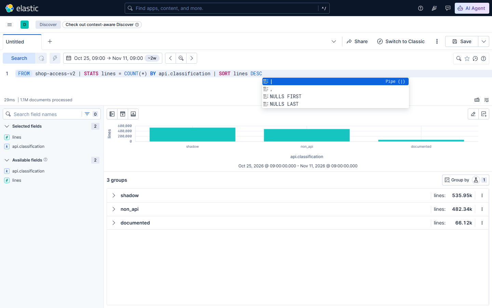
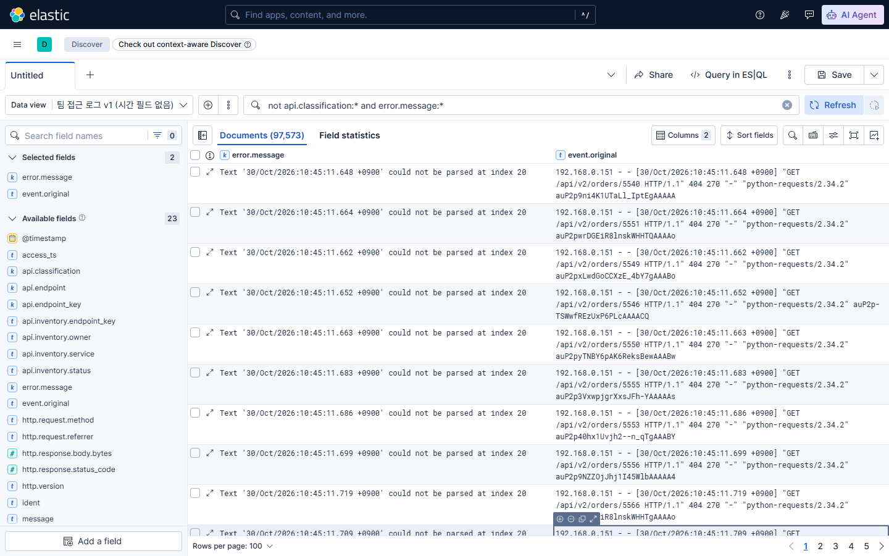
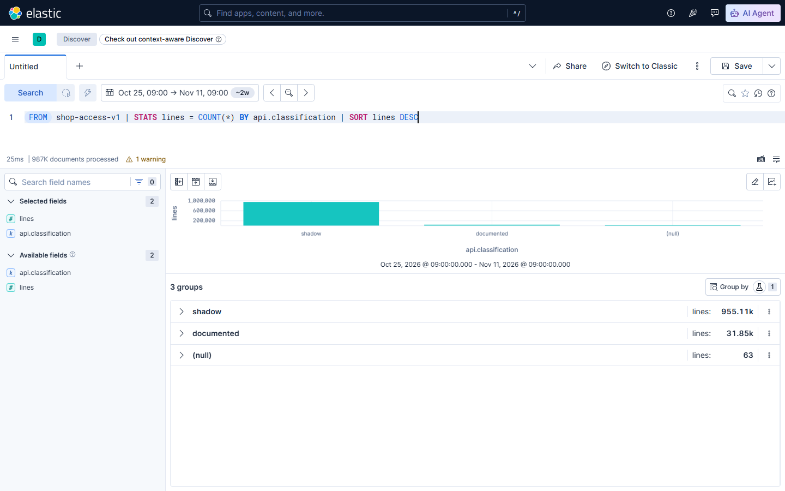
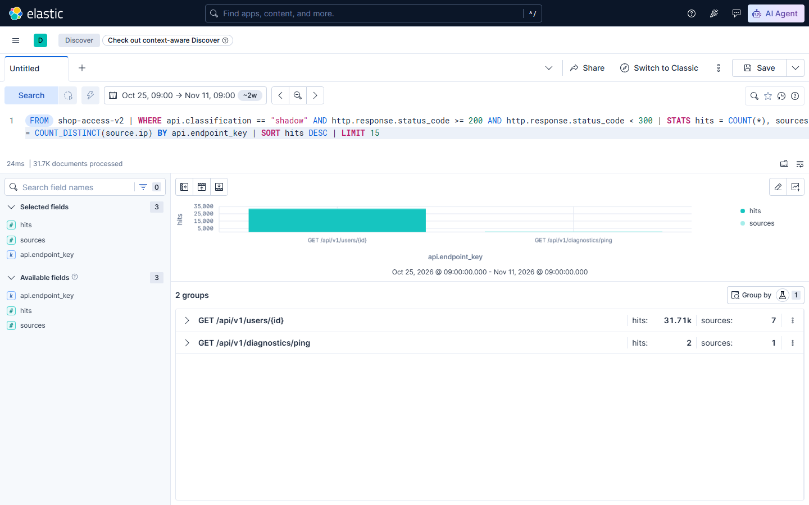
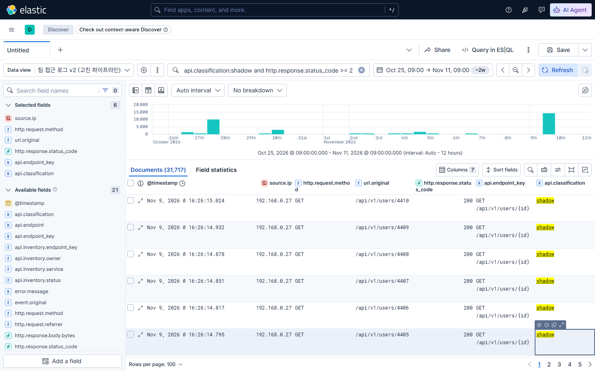

# ELK Shadow API 분류 — 팀 실제 로그에 적용 (2026-11-18, 로컬 재현)

팀 인프라에서는 ELK 파이프라인(명세 대조 → `api.classification`)과 탐지가 동작했지만, **팀 웹의 실제 로그 형식이 달라서 적용하지 못했다.**
팀 환경은 없어졌으므로 같은 구성을 로컬 Docker 로 세우고, 남아 있는 팀 Apache 로그 전체(108만 줄)로 원인을 확인하고 고쳤다.

[](screenshots/kibana_v1_v2_walkthrough.webm)
녹화: [`screenshots/kibana_v1_v2_walkthrough.webm`](screenshots/kibana_v1_v2_walkthrough.webm) (v1 실패 → v2 분류 → Shadow 성공 응답 순서)

## 결과

| | 가이드 파이프라인 (v1) | 고친 파이프라인 (v2) |
|---|---|---|
| 전체 | 1,084,528 | 1,084,528 |
| **분류 안 됨 (오류)** | **97,573 (9.0%)** | 120 (0.01%) |
| └ 밀리초 시각에서 날짜 단계 실패 | 97,390 | 0 |
| └ 요청 줄이 깨진 스캐너 요청 (`"FLT2002"`, `"GET HTTP/1.1"`) | 120 | 120 (정상 — 파싱 대상 아님) |
| └ enrich 대기열 초과 (`queue at capacity [1024/1024]`) | 63 | 0 |
| `@timestamp` 없음 → **시간 범위로 거르는 화면·대시보드에서 안 보임** | 97,510 | 120 |
| shadow | 955,107 | 535,950 |
| non_api (`/`, 정적 파일, `.php` 페이지 등) | (shadow 에 섞임) | 482,338 |
| documented | 31,848 | 66,120 |

**Shadow 중 실제로 성공 응답(2xx)한 엔드포인트 (v2)**

| 엔드포인트 | 성공 응답 | 출발지 |
|---|---|---|
| `GET /api/v1/users/{id}` | 31,715 | 7 |
| `GET /api/v1/diagnostics/ping` | 2 | 1 |

Wazuh 쪽 판정(`api-security-supply-chain/standardize/policy/offspec_triage`, app.log 기준)이 "높음"으로 꼽은 두 엔드포인트(BOLA · RCE)와 같다 — 룰 방식과 인덱스 방식이 같은 결론.

## 원인과 수정 (v1 → v2)

| # | 원인 | 영향 | 수정 |
|---|---|---|---|
| 1 | 10-29 부터 Apache 시각에 밀리초가 붙음 (`10:58:35.232`). 가이드의 `date` 는 옛 형식만 받음 | 그 뒤 로그 9%가 `on_failure` 로 빠져 **정규화 · 명세 대조 · 분류가 안 붙고 `@timestamp` 도 없음** → 대시보드에서 사라짐 | `formats` 에 `dd/MMM/yyyy:HH:mm:ss.SSS Z` 추가 (`pipeline_v2_teamlog.json`) |
| 2 | 명세 범위 밖 요청(`/`, `/css/…`, `.php`)도 명세에 없으니 shadow | shadow 가 실제의 1.8배로 부풀어 의미 없는 숫자가 됨 | `/api/` 로 시작하지 않으면 `non_api` |
| 3 | 줄 끝에 요청 ID 가 붙음 (`… "Mozilla/5.0 …" avK-P2Uy…`) | 없음 — grok 끝의 `.*` 가 흡수 | 그대로 |
| 4 | 대량 적재 때 enrich 대기열 초과 (63줄) | 적재 속도 문제. Filebeat 의 실제 수집 속도에서는 드묾 | v2 적재에서는 0. 운영에서는 `error.message` 감시 |

노션 "ELK 구축 기록" 6-1 에 적어 둔 문제(밀리초)가 실제로 9% 손실이었다는 것을 숫자로 확인했다.

## 화면

| | |
|---|---|
|  v1: 분류 안 된 97,573줄, 날짜 파싱 오류 |  v1: 시간 범위 안에는 98.7만 건만 — 실패한 줄은 빠짐 |
|  v2: shadow · non_api · documented |  v2: Shadow 성공 응답 엔드포인트 |
|  v2: `GET /api/v1/users/{id}` 순차 조회 원문 (`192.168.0.27`) | |

## 따라 하기

```bash
cd /d/api-security-supply-chain/elk_local_2026-11-18
docker network create elk-local
docker run -d --name es-local --net elk-local -p 127.0.0.1:9200:9200 -e discovery.type=single-node -e xpack.security.enabled=false -e ES_JAVA_OPTS="-Xms2g -Xmx2g" docker.elastic.co/elasticsearch/elasticsearch:9.5.5
docker run -d --name kb-local --net elk-local -p 127.0.0.1:5601:5601 -e ELASTICSEARCH_HOSTS=http://es-local:9200 docker.elastic.co/kibana/kibana:9.5.5
bash setup.sh                      # 인벤토리 · enrich · 파이프라인 v1/v2 · 인덱스 템플릿
python load.py <shop_access.log> shop-access-v2 api-access-v2      # 약 8분
```

- 보안을 끈 **로컬 전용** 구성이다(127.0.0.1 에만 열림). 팀 환경 가이드(`docs/02_ELK_구축_가이드라인.md`)는 보안 · API 키를 쓴다.
- 팀 로그 원본은 레포에 넣지 않는다(실습망 IP · 사용자 행동 포함).
- 캡처: `node capture_kibana.js screenshots` (playwright-core + 로컬 Chrome)

## 한계

- 로그는 파일에서 `_bulk` 로 넣었다. Filebeat → SSH 터널 경로는 다시 확인하지 않았다.
- `non_api` 는 `/api/` 접두어 가정이다. 다른 앱은 범위를 명세에서 뽑아야 한다(v2_portable 의 `derive_scope` 와 같은 문제).
- 정규화는 숫자 · UUID · 16자 이상 hex 만 `{id}` 로 묶는다. `/api/v1/users/me` 같은 문자열은 그대로 남는다.
