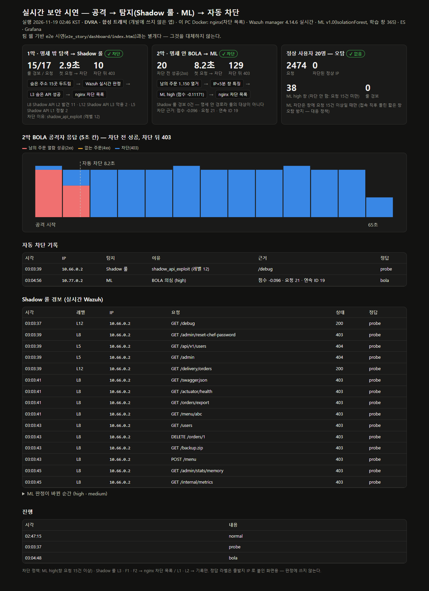

# 실시간 보안 시연 (DVRA · 합성 트래픽) — 공격 → 실시간 탐지 → 자동 차단 (2026-11-19)

> 팀 웹 기반 e2e 시연(작업 레포 `e2e_story/dashboard/index.html`, 비공개 — 팀 웹 로그 사용)과는 별개다 — 그것을 대체하지 않는다. 트래픽은 시험 장치가 만든 합성이다.

영상(4배속, 2분 33초): [`run_20261119_0246/live_demo_4x.mp4`](run_20261119_0246/live_demo_4x.mp4) · 보고서: [`run_20261119_0246/dashboard.html`](run_20261119_0246/dashboard.html)

## 결과 (run_20261119_0246)

| 막 | 공격 | 탐지 | 결과 |
|---|---|---|---|
| 1막 | 명세 밖 탐색 15곳 (10.66.0.2) | 실시간 Wazuh — 첫 숨은 API `/debug` 200 을 **L3(레벨 12)** 로 판정 | **2.9초** 만에 자동 차단, 이후 탐색 요청 10건 403 |
| 2막 | 명세 안 BOLA — 남의 주문 1..150 (10.77.0.2) | ML — 요청 21 · 연속 ID 19 · 점수 −0.096 (Shadow 룰 경보 0건: 룰의 대상이 아님) | **8.2초** 만에 자동 차단 — 남의 주문 **20건** 열린 뒤 나머지 129건 403 |
| 정상 20명 | — | ML high 창 **38개** | **차단 0건** — 모두 창 요청 15건 미만이라 차단 정책에서 걸러짐 |

- **정상 high 38창은 모델의 한계다.** 합성 정상(기계 패턴)의 짧은 창을 모델이 이상으로 본다. 차단 정책(창 요청 15건 이상)이 막았을 뿐 모델이 해결한 것이 아니다 — 같은 문제를 crAPI 에서는 사람 속도 정상(공개 데이터 재생)을 학습에 넣어 줄였다(115/120 → 3/120).
- 새벽에 Windows 가 백그라운드 타이머를 늦춰 `demo.sh` 의 4분 대기가 15분 넘게 걸렸다 → 공격은 손으로 실행했다(`demo_console.log` 시각). 정상 트래픽도 평소의 약 1/5 속도였다.

## 구성 (이 PC Docker)

| 부품 | 역할 |
|---|---|
| `nginx.conf` | 접속 기록 + 차단 목록(`blocked/ips.map`)의 IP 는 403. 목록이 바뀌면 자동 reload |
| Wazuh manager 4.14.6 | 접속 로그를 **실시간**으로 읽어 Shadow 룰 판정 (`wazuh_localfile.xml`) — **취약점 탐지는 끈다** (아래) |
| `pipeline.py` | 5초마다 로그 · 경보 → ES, ML v1.0 채점, 차단 정책 → 차단 목록 |
| `build_live_dashboard.py` | Grafana 실시간 대시보드(3001, 5초 새로고침) 코드 |
| `report_live.py` | 실행 한 번 → HTML 보고서 (기존 e2e 보고서와 같은 디자인, `<run>/dashboard.html` 에만 씀) |
| `up.sh` · `demo.sh` · `attack.py` · `record_live.js` | 환경 올리기 · 시연 진행(정상 20명 + 4분 탐색 + 6분 BOLA) · 공격 · 녹화 |

차단 정책: ML high(창 요청 15건 이상) · Shadow 룰 L3 · F1 · F2 → 차단 / L1 · L2 → 기록만 / 허용 목록(헬스체크 `10.1.0.1`) → 기록만.

## 확인된 것

- 숨은 API(`/debug`) 호출 → 실시간 Wazuh L3 경보 → 파이프라인 자동 차단 → 다음 요청부터 `403` · 다른 IP 는 200 (스모크 시험).

## 실행하다 생긴 문제 (기록)

| 문제 | 원인 | 조치 |
|---|---|---|
| Docker 가 세 번 멈춤 (`read-only file system`, API 500) | 시연용 Wazuh manager 의 **취약점 탐지가 CVE 데이터를 내려받아 컨테이너가 16GB** 로 커짐 → C 드라이브 0GB | 컨테이너 삭제, `up.sh` 에서 취약점 탐지 끔(`queue/vd` 92KB 확인). C 공간 확보(사용자 파일 18.6GB 를 D 로 이동) |
| 파이프라인이 시작 직후 죽음 | ES 첫 응답 타임아웃 | ES 재시도 · 주기 단위 예외 처리 · `--restart unless-stopped` |
| 헬스체크 IP 가 ML 로 차단됨 | `up.sh` 가 `/healthcheck` 를 2초마다 15번 → ML high (`notes/run_2150_healthcheck_fp_events.jsonl`) | 허용 목록 `--allow` (실무에서도 모니터링 IP 는 허용 목록) |
| 접속 직후 몰린 짧은 창 오탐 우려 | 오늘 분석의 오탐 모양과 같음 | ML 차단은 창 요청 15건 이상일 때만 (대응 정책, 모델은 그대로) |
| 시연이 몇 분 만에 멈춤 (21:56 시작) | PC 절전 — 잠금 방지가 앞선 수집 때 걸어 둔 90분으로 끝나 있었음 | 절전 방지 다시 걸고 재실행 |
| 이전 실행 공격이 새 실행에 섞임 | 21:56 의 `demo.sh` 가 꺼지지 않고 깨어난 뒤 BOLA 를 보냄 | 전부 끄고 처음부터 (`ps` 로 확인) |

## 다시 돌리기

1. 절전 방지(전원 옵션) → `bash up.sh` → `bash demo.sh` (약 15분. 타이머가 늦으면 `python attack.py probe` · `python attack.py bola` 를 직접)
2. `python report_live.py <run>` → `<run>/dashboard.html`
3. 영상: `record_live.js` 가 남긴 webm → ffmpeg 4배속 (`setpts=PTS/4`)

**주의:** 이전 실행의 `demo.sh` 가 남아 있으면 공격이 섞인다(2026-11-19 02:45 에 실제로 섞임). 시작 전 `ps -ef | grep demo.sh` 로 확인.
